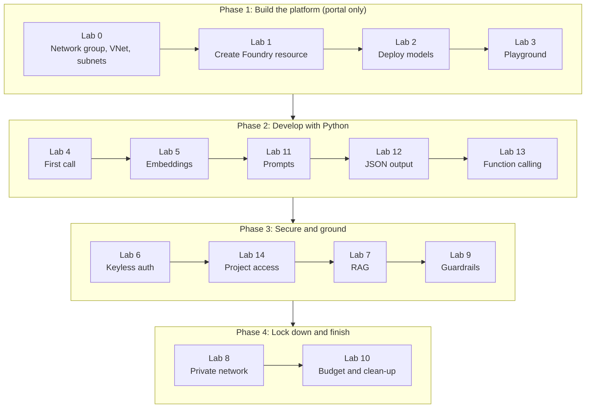
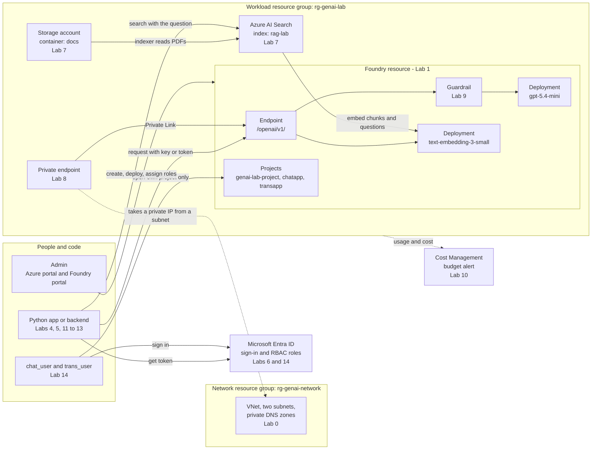
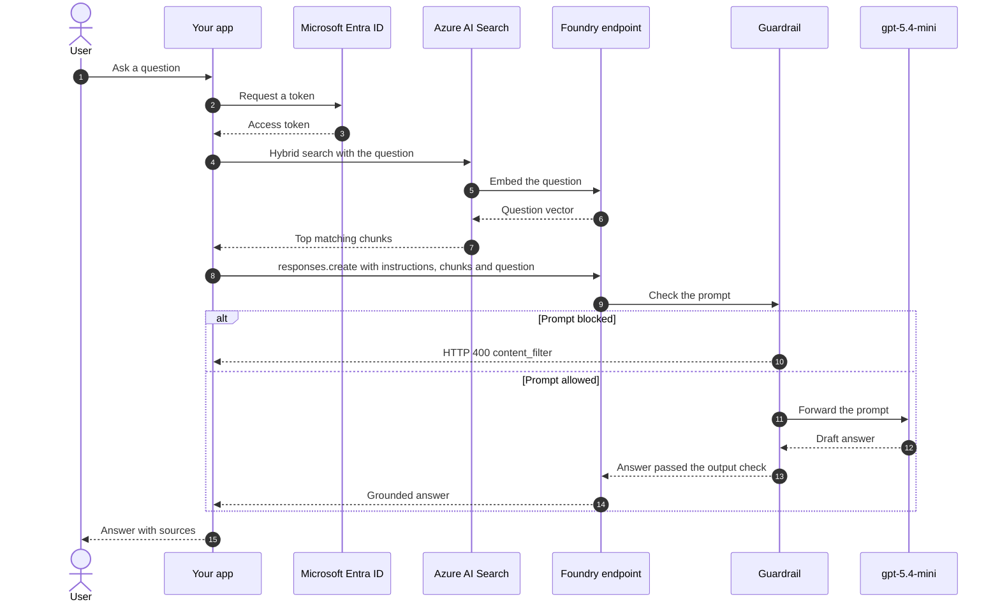
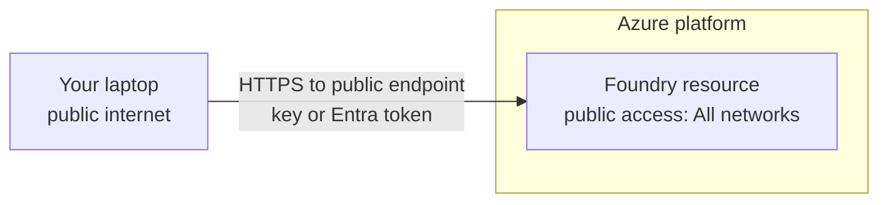
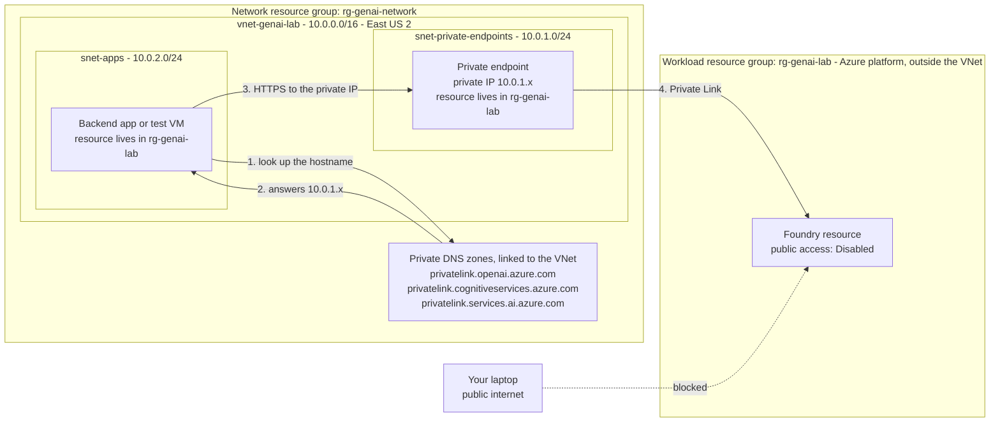
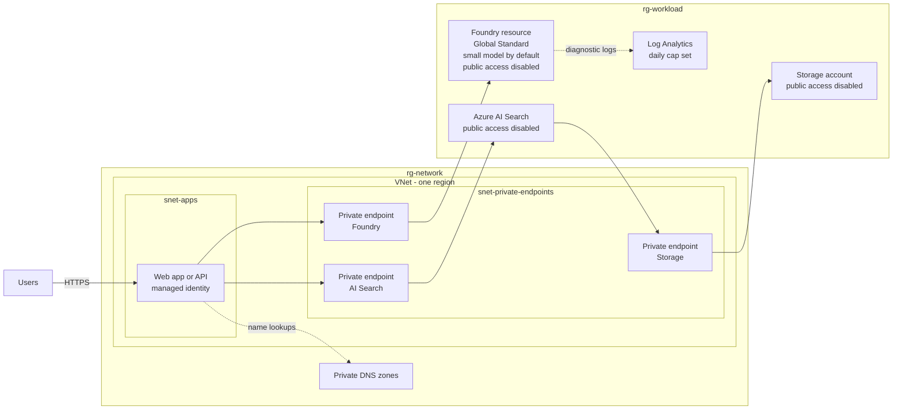

# Generative AI on Azure: Azure OpenAI in Microsoft Foundry (Hands-On Guide)

## Lab Index

Click a lab to jump to it. Every section has a **⬆ Back to Lab Index** link under its heading.

| Lab | What you do | Where | Python? | Extra cost |
| :--- | :--- | :--- | :---: | :--- |
| [**Lab 0: Create the Network Resource Group, VNet and Subnets**](#lab-0-create-the-network-resource-group-vnet-and-subnets) | Prerequisite: build the empty network first | Azure portal | No | None (free) |
| [**Lab 1: Create the Foundry Resource and Project**](#4-lab-1-create-the-foundry-resource-and-project) | Create the resource, find endpoint and key | Azure portal, Foundry portal | No | None |
| [**Lab 2: Deploy a Chat Model and an Embedding Model**](#5-lab-2-deploy-a-chat-model-and-an-embedding-model) | Deploy `gpt-5.4-mini` and `text-embedding-3-small` | Foundry portal | No | None until used |
| [**Lab 3: Test in the Playground and Tune Parameters**](#7-lab-3-test-in-the-playground-and-tune-parameters) | Chat with the model, change settings | Foundry portal | No | Tokens |
| [**Lab 4: Call the Model from Python**](#8-lab-4-call-the-model-from-python) | First script, multi-turn chat, streaming | Your machine | Yes | Tokens |
| [**Lab 5: Embeddings and Semantic Similarity**](#9-lab-5-embeddings-and-semantic-similarity) | Turn text into vectors and compare them | Your machine | Yes | Tokens |
| [**Lab 6: Keyless Authentication with Microsoft Entra ID**](#10-lab-6-keyless-authentication-with-microsoft-entra-id) | Assign a role, call the model with no key | Azure portal, your machine | Yes | None |
| [**Lab 7: RAG with Azure AI Search**](#11-lab-7-rag-with-azure-ai-search) | Index your PDFs and ask questions about them | Azure portal, your machine | Yes | **AI Search Basic, hourly** |
| [**Lab 8: Network Isolation with Private Endpoints**](#12-lab-8-network-isolation-with-private-endpoints) | Remove public access to the endpoint | Azure portal | No | Private endpoint, hourly |
| [**Lab 9: Guardrails and Content Safety**](#13-lab-9-guardrails-and-content-safety) | Create, assign and test a guardrail | Foundry portal | No | None |
| [**Lab 10: Cost Control and Clean-Up**](#14-lab-10-cost-control-and-clean-up) | Budget alert, usage, delete everything | Azure portal | No | None |
| [**Lab 11: Prompt Engineering**](#15-lab-11-prompt-engineering) | Write prompts that give reliable answers | Foundry portal, your machine | A little | Tokens |
| [**Lab 12: Structured Outputs (JSON)**](#16-lab-12-structured-outputs-json) | Get JSON that always matches your schema | Your machine | Yes | Tokens |
| [**Lab 13: Function Calling**](#17-lab-13-function-calling) | Let the model call your Python function | Your machine | Yes | Tokens |
| [**Lab 14: Project-Level Access for Two Users**](#18-lab-14-project-level-access-for-two-users) | Two projects, two users, each sees only their own | Azure portal, Foundry portal | No | None |

**Suggested order:** Lab 0 first, then Labs 1 to 5, then 11 to 13, then 6, 14, 7 and 9. Do Lab 8 near the end because it blocks access from your machine, and finish with the clean-up in Lab 10.

### Concepts and reference

| Section | Read it for | 
| :--- | :--- |
| [Prerequisites and Design](#prerequisites-and-design) | What you need first, the target layout, and when the VNet is needed |
| [Flow diagrams](#flow-diagrams) | Mermaid diagrams: lab journey, end-to-end architecture, one RAG request, network path |
| [1. Core Concepts](#1-core-concepts) | Tokens, context window, embeddings, RAG in plain words |
| [2. OpenAI API vs. Azure OpenAI in Microsoft Foundry](#2-openai-api-vs-azure-openai-in-microsoft-foundry) | Why a company picks Azure |
| [3. How Azure Organises It](#3-how-azure-organises-it-resource-project-deployment) | Resource, project, deployment, and the two portals |
| [6. Models, Deployment Types and Model Lifecycle](#6-models-deployment-types-and-model-lifecycle) | Which model to pick, where data is processed, retirement |
| [19. Troubleshooting](#19-troubleshooting) | What an error code means and how to fix it |
| [Reference Links](#reference-links) | The Microsoft Learn pages behind each lab |

---

**Names used in every lab** (change them once here and reuse):

| Thing | Value used in this guide |
| :--- | :--- |
| Network resource group | `rg-genai-network` (VNet, subnets, private DNS zones) |
| Workload resource group | `rg-genai-lab` (Foundry, storage, AI Search, private endpoint) |
| Region | `eastus2` (any region that offers your model works) |
| Foundry resource | `foundry-genai-lab-<yourname>` (must be globally unique) |
| Project | `genai-lab-project` |
| Chat deployment | `gpt-5.4-mini` |
| Embedding deployment | `text-embedding-3-small` |
| Virtual network (created in Lab 0, used in Lab 8) | `vnet-genai-lab`, address space `10.0.0.0/16` |
| Subnet for private endpoints (created in Lab 0, used in Lab 8) | `snet-private-endpoints`, `10.0.1.0/24` |
| Subnet for apps and test VM (created in Lab 0, used in Lab 8) | `snet-apps`, `10.0.2.0/24` |

---

## Prerequisites and Design

[⬆ Back to Lab Index](#lab-index)

### Before you start

* An Azure subscription with a payment method, and the **Owner** role on it (needed to assign roles in Labs 6 and 7).
* A browser for the two portals. Nothing else is needed for the portal-only labs.
* For the Python labs: Python 3.10 or later and a code editor.
* For the CLI blocks: Azure CLI 2.80.0 or later.

### Target design

The design follows the production pattern: **the network is isolated in its own resource group**, separate from the workloads that use it. Both groups are in one region.

```
Subscription                                                       (region: eastus2)
│
├── Resource group: rg-genai-network          NETWORK, long-lived, delete-locked
│   │
│   ├── Virtual network: vnet-genai-lab  10.0.0.0/16              Lab 0
│   │   ├── snet-private-endpoints  10.0.1.0/24                   holds private endpoint IPs
│   │   └── snet-apps               10.0.2.0/24                   holds apps, VMs, AKS nodes
│   │
│   └── Private DNS zones (privatelink.*)                          Lab 8
│
└── Resource group: rg-genai-lab              WORKLOAD, created and deleted freely
    │
    ├── Foundry resource: foundry-genai-lab-<yourname>            Labs 1-6, 9, 11-14
    │   ├── Projects: genai-lab-project, chatapp, transapp
    │   ├── Deployment: gpt-5.4-mini
    │   └── Deployment: text-embedding-3-small
    │
    ├── Storage account  (container: docs)                        Lab 7
    ├── Azure AI Search  (Basic tier, index: rag-lab...)          Lab 7
    │
    ├── Private endpoint: pe-foundry-genai-lab                    Lab 8
    │     └── its network card sits in snet-private-endpoints (other group)
    └── Test VM (optional)                                        Lab 8
          └── its network card sits in snet-apps (other group)
```

Why the network is kept apart:

| Reason | What it means |
| :--- | :--- |
| **Different lifecycle** | A VNet lives for years. Workloads are created, replaced and deleted. Deleting `rg-genai-lab` must never take the network with it |
| **Different owners** | A network team owns `rg-genai-network`. App teams own their workload groups and get no rights on the network group beyond joining a subnet |
| **Shared use** | One VNet serves many workloads (an AI app, a VM, AKS), each in its own subnet and its own resource group |
| **Protection** | The network group carries a delete lock and stricter policy without slowing down workload changes |

A workload never lives "inside" the network group. It lives in its own group and only **attaches** to a subnet: the private endpoint and the VM are resources in `rg-genai-lab` whose network cards take an IP from a subnet in `rg-genai-network`.
```

### Flow diagrams

These are Mermaid diagrams. GitHub renders them automatically. In VS Code, install the extension **Markdown Preview Mermaid Support**, then open the preview with `Ctrl+Shift+V`.

#### Diagram 1: The lab journey



#### Diagram 2: End-to-end architecture

Who talks to what, and which lab builds each piece.



#### Diagram 3: What happens on one RAG question

The order of calls for a single user question, including the guardrail checks.



Without RAG (Labs 4, 11, 12, 13) steps 4 to 7 are skipped: the app goes straight from the token to `responses.create`. With an API key in place of Entra ID, steps 2 and 3 are skipped too.

#### Diagram 4: Network path, before and after Lab 8

**Before Lab 8 (default):** the endpoint is public. Anyone with a valid key or token can reach it from anywhere.



**After Lab 8 (private endpoint only):** the public path is closed. Only callers inside the VNet reach the model.



Read it as: the app never changes its URL. The private DNS zone makes the same hostname resolve to the private endpoint's IP, and the private endpoint carries the traffic to the Foundry resource over Microsoft's network.

### Lab 0: Create the Network Resource Group, VNet and Subnets

Do this first. It builds the isolated network group from the target design. The workload group `rg-genai-lab` is not created here; Lab 1 creates it together with the Foundry resource. A resource group, a VNet, subnets and a lock are all **free**.

#### Step 1: Create the network resource group

1. **Azure portal** → search **Resource groups** → **+ Create**.
2. **Subscription:** your subscription. **Resource group:** `rg-genai-network`. **Region:** `East US 2`.
3. **Review + create** → **Create**.

#### Step 2: Create the virtual network and both subnets in the network group

1. **Azure portal** → **Create a resource** → search **Virtual network** → **Create**.
2. **Basics:** resource group **`rg-genai-network`**, name `vnet-genai-lab`, region `East US 2`.
3. **IP addresses** tab: set the address space to `10.0.0.0/16`.
4. Edit the `default` subnet: rename it `snet-private-endpoints`, range `10.0.1.0/24` → **Save**.
5. Select **+ Add a subnet**: name `snet-apps`, range `10.0.2.0/24` → **Add**.
6. **Review + create** → **Create**.

#### Step 3: Protect the network group with a delete lock

1. Open the resource group `rg-genai-network` → **Settings** → **Locks** → **+ Add**.
2. **Lock name:** `do-not-delete`. **Lock type:** **Delete**. → **OK**.

Nobody, including you, can now delete the VNet by accident. You remove this lock in Lab 10 before clean-up.

#### Step 4: Check it

1. Open `rg-genai-network`. It should contain only `vnet-genai-lab`.
2. Open `vnet-genai-lab` → **Settings** → **Subnets**. You should see exactly these two:

| Subnet | Range | What attaches to it | Used in |
| :--- | :--- | :--- | :--- |
| `snet-private-endpoints` | `10.0.1.0/24` | The private endpoint that leads to the Foundry resource | Lab 8 |
| `snet-apps` | `10.0.2.0/24` | Your backend app, a test VM or AKS nodes: the callers of the model | Lab 8 |


<details>
<summary>▶ Azure CLI: create the network resource group, the VNet, both subnets and the lock</summary>

```bash
az login

az group create --name rg-genai-network --location eastus2

az network vnet create \
    --name vnet-genai-lab \
    --resource-group rg-genai-network \
    --location eastus2 \
    --address-prefixes 10.0.0.0/16 \
    --subnet-name snet-private-endpoints \
    --subnet-prefixes 10.0.1.0/24

az network vnet subnet create \
    --name snet-apps \
    --vnet-name vnet-genai-lab \
    --resource-group rg-genai-network \
    --address-prefixes 10.0.2.0/24

az lock create \
    --name do-not-delete \
    --resource-group rg-genai-network \
    --lock-type CanNotDelete

# Should list both subnets
az network vnet subnet list \
    --vnet-name vnet-genai-lab \
    --resource-group rg-genai-network \
    --query "[].{name:name,range:addressPrefix}" --output table
```

</details>

#### Who gets access to what (production practice)

In these labs you are Owner of everything. In a real team the access is split:

| Team | On `rg-genai-network` | On `rg-genai-lab` |
| :--- | :--- | :--- |
| Network team | **Network Contributor** | None |
| App / AI team | **Reader**, plus permission to join the specific subnet they were given | **Contributor** |

The app team can attach a private endpoint or a VM to their subnet, but cannot change address ranges, routes or DNS.

### How the network is used across the labs

The VNet sits idle until Lab 8. A Foundry resource is a platform service: it is not placed inside a VNet when you create it, unlike a virtual machine. You connect it to the VNet later with a private endpoint, without recreating anything.

| Labs | Network in use | Why |
| :--- | :--- | :--- |
| 0 | Creates the network group, the VNet and two subnets | Network-first and isolated, the way a real project starts |
| 1 to 7, 9 to 14 | **Public endpoint.** The VNet is not used | You call the model from your own machine, and the Lab 7 wizard requires public access |
| 8 | **Private endpoint in the VNet** | Public access is switched off and traffic moves into the VNet |

Design rules to remember:

* The **private endpoint must be in the same region as the VNet**. The Foundry resource it points to can be in any region.
* Keep the **network in its own resource group**. Workloads attach to a subnet from their own group.
* Give private endpoints **their own subnet**. Apps go in a different subnet.
* Put **private DNS zones with the network**, because every workload on the VNet depends on them.
* A real production design starts network-first: VNet, subnets and private DNS zones exist before any AI resource, and the resource is created with public access already disabled (the **Network** tab in Lab 1, Option B).

### Networking facts to remember

#### 1. The Foundry resource is never inside your VNet

It is a platform service that runs on Microsoft-managed infrastructure. Azure does **not** create a VNet or any network components in your subscription for it. You build the network and you control the path to the service.

| | Can you do it? |
| :--- | :--- |
| Place the Foundry resource itself inside your VNet or subnet | **No.** It always runs on Microsoft-managed infrastructure |
| Choose which VNet and subnet can reach it | **Yes.** Create a private endpoint in your subnet (Lab 8) |
| Block everyone outside your VNet | **Yes.** Set public access to **Disabled** |
| Allow only specific subnets or IP addresses over the public endpoint | **Yes.** The **Selected networks** option (Lab 8) |

Compare: a VM, AKS nodes or an application gateway **are** deployed into a subnet you choose and take IP addresses from it. Foundry, Storage and AI Search are not; you reach them through a private endpoint.

#### 2. Who builds what

| Piece | Labs | Production |
| :--- | :--- | :--- |
| VNet and subnets | You create them (Lab 0) | You or the network team create them first |
| Foundry resource | Created public, locked down later (Lab 8) | Created with public access **Disabled** from the start |
| Private endpoint | You add it in Lab 8 | You add it during or right after creation |
| Private DNS zones, VNet link, DNS record | Created automatically by the private endpoint wizard | Same, or pre-created by the network team |
| Where the Foundry resource runs | Microsoft's infrastructure | Microsoft's infrastructure |

#### 3. Region rules

Your VM, AKS, database and the Foundry resource do **not** have to be in the same region.

| Pair | Same region required? |
| :--- | :--- |
| Private endpoint and its VNet / subnet | **Yes.** This is the only hard rule |
| Private endpoint and the Foundry resource it points to | No. The endpoint can reach a Foundry resource in any region |
| VM / AKS and the private endpoint | No, but they must be in the same VNet, or in a VNet peered to it, with the private DNS zones linked to that VNet too. Peering works across regions |
| VM / AKS / database and the Foundry resource | No |

**Example that works:** VM, AKS and database in a South India VNet. Foundry resource in East US 2, because the model you need is offered there. The private endpoint is created in the South India VNet and points to the East US 2 Foundry resource. Traffic stays on Microsoft's network end to end.

Keep everything in one region when you can, for these reasons:

| Reason | Why it matters |
| :--- | :--- |
| **Speed** | Every call crosses the distance between the regions, which adds latency |
| **Data residency** | Data at rest stays in the Foundry resource's region. If rules say data must stay in one country, a private connection does not fix a resource placed elsewhere |
| **Cost** | Traffic between regions can carry data transfer charges |
| **Simplicity** | One region means one place to look when something fails |

In practice, model availability often decides it: the Foundry resource goes where the model you need is offered, and everything else stays close to your users.

#### 4. Your own domain and DNS

* **Your public domain (GoDaddy or any registrar) is not involved in any lab.** Your app calls a Microsoft hostname such as `foundry-genai-lab-<yourname>.openai.azure.com`, not a name on your domain.
* **A private DNS zone is different from public DNS.** It answers only machines inside your VNet, and tells them the Foundry hostname points to the private IP `10.0.1.x`.
* **You add no records by hand.** With **Integrate with private DNS zone** set to **Yes**, the private endpoint wizard creates the three `privatelink.*` zones, links them to the VNet and adds the record. Deleting the endpoint removes the record.
* **The Azure CLI route does not do this.** The CLI block in Lab 8 creates only the endpoint, so use the portal steps for DNS.
* **You touch your registrar only for your own names**, such as `chat.yourdomain.com` for a web app you host, or a custom sign-in domain for users. Even then the record points to your app, never to the model endpoint.

### Industry best practices for a production setup

These are the practices commonly applied to Azure AI workloads. The "In these labs" column shows where the guide already does it, and where it takes a shortcut.

#### Network

| Practice | Why | In these labs |
| :--- | :--- | :--- |
| **Disable public access** and reach the service only through a private endpoint | Removes the internet as a way in | Lab 8 |
| **Hub-and-spoke network.** A shared hub VNet holds common services; each workload gets its own spoke VNet, peered to the hub | Isolation between workloads, shared services paid for once | Shortcut: one VNet |
| **Network in its own resource group** (or its own subscription in a large company) | Different owners and lifecycle | Lab 0 |
| **A dedicated subnet for private endpoints,** separate from app subnets | Clear rules and easier auditing | Lab 0 |
| **Central private DNS zones,** one set for the whole company, linked to every VNet that needs them | Avoids duplicate zones that give conflicting answers | Lab 8 puts them in the network group |
| **Network security groups on app subnets,** allowing only the traffic that is needed | Limits what a compromised machine can reach | Not covered |
| **Use private endpoints for every data service** in the path: Storage and AI Search as well as Foundry | One public service undoes the rest | Shortcut: only Foundry is made private |

#### Identity and access

| Practice | Why | In these labs |
| :--- | :--- | :--- |
| **Microsoft Entra ID, never API keys.** Turn key authentication off | Every call is tied to an identity and can be revoked | Lab 6 |
| **Managed identity for apps** | No secret to store, rotate or leak | Lab 6 explains it |
| **Least privilege, assigned at the smallest scope,** to groups and not to individuals | Limits damage from a mistake or a stolen account | Lab 14 |
| **Separate resources for dev, test and production** | Tests never touch production data or quota | Shortcut: one environment |

#### Governance and operations

| Practice | Why | In these labs |
| :--- | :--- | :--- |
| **Infrastructure as code** (Bicep or Terraform) instead of portal clicks | Repeatable, reviewable, recoverable | CLI blocks are a first step |
| **Azure Policy** to block public endpoints, restrict regions and deployment types | Rules enforce themselves | Mentioned in section 6 |
| **Diagnostic logs to a Log Analytics workspace,** with alerts on errors and throttling | You can see who called what, and when it failed | Not covered |
| **Delete locks on shared resources** | Prevents accidental loss | Lab 0 |
| **Tags on every resource** (owner, environment, cost centre) | Cost and ownership stay traceable | Not covered |
| **Guardrails on every deployment,** with Prompt Shields for indirect attacks when using RAG | Protects against harmful output and prompt injection | Lab 9 |
| **Plan for model retirement:** pin versions, test the replacement before the date | Models are removed on a schedule | Section 6 |
| **An AI gateway (Azure API Management) in front of the models** | One place for per-team token limits, logging, and load balancing across deployments or regions | Not covered |
| **A second region for critical apps** | Survives a regional outage or a capacity shortage | Not covered |

### Cost-effective architecture

Security features are not free. The aim is to pay for the protection the workload needs and nothing more.

#### What each component costs

Relative cost only; check the Azure pricing calculator for figures.

| Component | Cost | Notes |
| :--- | :--- | :--- |
| Resource groups, VNet, subnets, peering setup, NSGs, locks, RBAC, Azure Policy | **Free** | Use them freely |
| Service endpoint with **Selected networks** | **Free** | Restricts access to chosen subnets without a private endpoint |
| Private DNS zone | **Low** | Small monthly charge per zone |
| Private endpoint | **Low** | Hourly charge per endpoint, plus a small charge per GB |
| Model usage on Global Standard | **Low to high** | Depends entirely on the model and volume (section 6) |
| Log Analytics | **Low to medium** | Billed per GB ingested. Set a retention period and a daily cap |
| Azure AI Search | **Medium** | Billed per hour whether used or not. Usually the largest fixed cost in a RAG app |
| API Management | **Medium to high** | Depends on the tier |
| Jump host access (Azure Bastion) | **Medium** | Billed per hour |
| Provisioned throughput (PTU) | **High** | Fixed monthly commitment |
| Azure Firewall | **High** | Large fixed hourly charge. Often the most expensive item in a small setup |

#### Three sizes of architecture

| | Learning (these labs) | Small production, cost-effective | Enterprise |
| :--- | :--- | :--- | :--- |
| **Network** | One VNet, used only in Lab 8 | One VNet, two or three subnets | Hub-and-spoke, firewall in the hub |
| **Access to Foundry** | Public endpoint | Private endpoint, public access disabled | Private endpoint, public access disabled |
| **Access to Storage and AI Search** | Public | Private endpoints | Private endpoints |
| **Authentication** | Key, then Entra ID | Entra ID and managed identity only | Entra ID and managed identity only |
| **Gateway** | None | None, or API Management on a low tier | API Management with token limits per team |
| **Deployment type** | Global Standard | Global Standard, or Data Zone if rules require | Data Zone or Provisioned, plus Batch |
| **Regions** | One | One | Two or more |
| **Logging** | None | Log Analytics with a daily cap | Central logging and security monitoring |
| **Relative monthly fixed cost** | Near zero when idle | Low to medium | High |

#### Recommended cost-effective production design

One region, one VNet, private endpoints for every data service, no firewall and no gateway until there is a reason for them.



#### Where the savings come from

| Saving | How |
| :--- | :--- |
| **Share the network** | One VNet, one set of private DNS zones and one private-endpoint subnet serve every workload |
| **Share the Foundry resource** | One resource with a project per team (Lab 14) instead of a resource per team, unless hard isolation is required |
| **Skip the firewall until required** | Private endpoints and NSGs already give strong isolation. Add a firewall when policy demands outbound inspection |
| **Skip the gateway until required** | Add API Management when several teams share models and you need per-team limits |
| **Right-size AI Search** | Start on the smallest tier that supports what you need, and share one service across applications |
| **Stay on Global Standard** | Lowest token price. Move to Data Zone only when residency rules require it, and to Provisioned only when usage is high and steady |
| **Default to a small model** | Send only hard requests to a larger model, or let `model-router` choose |
| **Use Batch and caching** | Batch is about half price for work that can wait. Put fixed prompt text first so repeated prefixes are billed at the cached rate |
| **Keep to one region** | Avoids cross-region data transfer charges and duplicate resources |
| **Cap everything** | Low tokens-per-minute on deployments, `max_output_tokens` on calls, a daily cap on logs, budget alerts on each resource group |
| **Turn off what is idle** | Stop or delete test VMs, and delete dev environments that are not in use. Infrastructure as code makes them cheap to recreate |

**Where not to save:** do not keep public access on, use API keys, or skip guardrails to save money. Those are the free or low-cost controls, and they prevent the incidents that cost the most.

---

## 1. Core Concepts

[⬆ Back to Lab Index](#lab-index)

* **Generative AI:** models that produce new text, images, code, audio or video from patterns learned in training.
* **Foundation model:** a large model trained on broad data that can be used for many tasks without retraining.
* **Large Language Model (LLM):** a foundation model for understanding and generating language. Current GPT models also accept images as input.
* **Reasoning model:** a model that "thinks" before it answers. The thinking uses hidden *reasoning tokens*, which you pay for as output tokens. All current GPT-5.x and GPT-6 models are reasoning models.
* **Token:** the unit a model reads and writes. Roughly, 1,000 tokens is about 750 English words. You are billed per token.
* **Context window:** the most tokens one request can hold, counting instructions, history, retrieved documents and the answer.
* **Embedding:** a list of numbers that represents the meaning of a text, so that similar texts have similar numbers.
* **RAG (Retrieval-Augmented Generation):** look up relevant chunks of your own documents first, then give them to the model with the question.

---

## 2. OpenAI API vs. Azure OpenAI in Microsoft Foundry

[⬆ Back to Lab Index](#lab-index)

The models are the same. The difference is where they run and how you control access.

| Dimension | OpenAI API | Azure OpenAI in Microsoft Foundry |
| :--- | :--- | :--- |
| **Hosting** | OpenAI's platform | Microsoft Azure regions, inside your subscription |
| **Your data** | OpenAI API data terms | Prompts and outputs are not used to train models and are not shared with OpenAI |
| **Authentication** | API keys | API keys or Microsoft Entra ID with Azure RBAC |
| **Network** | Public endpoint | Public, selected networks, or private endpoints only |
| **Data residency** | Limited choice | Choose Global, Data Zone (US / EU / APAC) or a single geography |
| **Compliance** | OpenAI's certifications | Azure compliance portfolio (ISO, SOC, HIPAA and others) |
| **Billing** | OpenAI account | Your Azure subscription, with budgets and cost alerts |
| **Other models** | OpenAI models only | Same endpoint also serves Claude, Grok, DeepSeek, Llama, Mistral and Phi models |

---

## 3. How Azure Organises It: Resource, Project, Deployment

[⬆ Back to Lab Index](#lab-index)

```
Azure subscription
└── Resource group: rg-genai-lab
    └── Foundry resource: foundry-genai-lab-<yourname>      (kind: AIServices)
        │   Holds: endpoint, keys, networking, identity, billing
        │
        ├── Project: genai-lab-project                      (groups your work)
        │
        ├── Deployment: gpt-5.4-mini            → model gpt-5.4-mini (2026-03-17)
        └── Deployment: text-embedding-3-small  → model text-embedding-3-small (1)
```

* **Foundry resource:** the Azure resource you create. It gives you one endpoint and one set of keys for Azure OpenAI and the other Foundry tools.
* **Project:** a workspace inside the resource for models, agents and evaluations.
* **Deployment:** a model made callable under a name you choose. Your code sends the **deployment name** in the `model` field, not the underlying model name. Keeping the two identical is fine for learning.

You work in two portals:

| Portal | URL | Use it for |
| :--- | :--- | :--- |
| **Azure portal** | https://portal.azure.com | Create the resource, keys, access control (IAM), networking, cost, delete |
| **Microsoft Foundry portal** | https://ai.azure.com | Projects, deploy models, playground, guardrails |

---

## 4. Lab 1: Create the Foundry Resource and Project

[⬆ Back to Lab Index](#lab-index)

**You need:** an Azure subscription and the **Owner** role on it (or on the resource group). Owner is needed later to assign roles. No access request form is needed for the models used here.

### Option A: Foundry portal (fastest, creates resource and project together)

1. Open https://ai.azure.com and sign in.
2. Make sure the **New Foundry** toggle at the top is **on**.
3. First visit: in the project dropdown select **Create a new project**. Otherwise: select the project name in the upper-left corner, then **Create new project**.
4. **Project name:** `genai-lab-project`.
5. Select **Advanced options**:
   * **Resource group:** create new → `rg-genai-lab`. This is the workload group, separate from `rg-genai-network`.
   * **Location:** `East US 2`.
6. Select **Create project** and wait for the project overview page.

### Option B: Azure portal (more control over network, identity and tags)

1. Open the create page directly: https://portal.azure.com/#create/Microsoft.CognitiveServicesAIFoundry
   (or search the top bar for **Microsoft Foundry** → **Create**).
2. On the **Basics** tab fill in:
   * **Subscription:** your subscription.
   * **Resource group:** **Create new** → `rg-genai-lab`. This is the workload group, separate from `rg-genai-network`.
   * **Region:** `East US 2`.
   * **Name:** `foundry-genai-lab-<yourname>`.
3. Leave **Network** on **All networks** for now (Lab 8 locks it down). Leave **Identity**, **Encryption** and **Storage** on defaults.
4. Select **Review + create**, then **Create**.
5. When deployment finishes select **Go to resource**. On the **Overview** page check **Status** is available.
6. Open the Foundry portal (https://ai.azure.com) and select your project. If the **Basics** tab showed a default project name field, the project was created with the resource (enter `genai-lab-project` there). If you see no project, select **Create new project** and name it `genai-lab-project`.

One Foundry resource can hold many projects. The resource owns what is shared (endpoint, keys, networking, billing, model deployments); each project is a workspace for one use case or team, with its own agents, evaluations and user access. One project is enough for these labs.

<details>
<summary>▶ Azure CLI: create resource group, Foundry resource and project</summary>

Needs Azure CLI 2.80.0 or later (`az version`, then `az upgrade` if older).

```bash
az login

az group create --name rg-genai-lab --location eastus2

# --custom-domain must be globally unique. --allow-project-management cannot be changed later.
az cognitiveservices account create \
    --name foundry-genai-lab-<yourname> \
    --resource-group rg-genai-lab \
    --kind AIServices \
    --sku S0 \
    --location eastus2 \
    --custom-domain foundry-genai-lab-<yourname> \
    --assign-identity \
    --allow-project-management true

az cognitiveservices account project create \
    --name foundry-genai-lab-<yourname> \
    --resource-group rg-genai-lab \
    --project-name genai-lab-project \
    --location eastus2

# Should print: Succeeded
az cognitiveservices account show \
    --name foundry-genai-lab-<yourname> \
    --resource-group rg-genai-lab \
    --query properties.provisioningState --output tsv
```

</details>

### Find your endpoint and key

1. In the **Azure portal**, open the resource `foundry-genai-lab-<yourname>`.
2. In the left menu select **Resource Management** → **Keys and Endpoint**.
3. Copy **KEY 1** and the endpoint. You use them in Lab 4.

<details>
<summary>▶ Azure CLI: show endpoint and key</summary>

```bash
az cognitiveservices account show \
    --name foundry-genai-lab-<yourname> \
    --resource-group rg-genai-lab \
    --query properties.endpoint --output tsv

az cognitiveservices account keys list \
    --name foundry-genai-lab-<yourname> \
    --resource-group rg-genai-lab \
    --query key1 --output tsv
```

</details>

---

## 5. Lab 2: Deploy a Chat Model and an Embedding Model

[⬆ Back to Lab Index](#lab-index)

### Deploy the chat model

1. In the **Foundry portal**, open `genai-lab-project`.
2. Open the model list. Either route works and both end at the same model card:
   * **Build route:** select **Build** in the upper-right navigation, then **Models** in the left pane, then **Deploy** → **Deploy a base model**.
   * **Discover route:** select **Discover** in the upper-right navigation, then **Models** in the left pane. This is the full model catalog, with descriptions and comparisons.
3. Use **Build** when you already know the model you want. Use **Discover** when you want to browse and compare first. Afterwards, your deployed models are always listed under **Build** → **Models**.
4. Search for **gpt-5.4-mini** and select it.
   * **Check where it is offered:** on the right side of the model page, find **Availability** and select **View availability**. It shows the regions and deployment types for this model. Confirm your resource's region is listed before you deploy.
   * **Check what it costs:** the same model page has a **pricing** chart showing the input and output price for this model. This is the live price, so trust it over the numbers in section 6 if they differ, and use it to compare models before you choose one.
5. Select **Deploy** → **Default settings**. (Choose **Custom settings** if you want to change the deployment name, deployment type or tokens-per-minute limit.)
6. The portal opens the playground when the deployment succeeds. Note the deployment name: `gpt-5.4-mini`.

### Deploy the embedding model

Repeat steps 2 to 5 and search for **text-embedding-3-small**. Note the deployment name.

### If the model is not listed or cannot be deployed

Start on the model page itself: on the right side, under **Availability**, select **View availability** to see the regions and deployment types this model is offered in. Then work through these three checks in order.

| Check | What to look at | Fix |
| :--- | :--- | :--- |
| **1. Region of your Foundry resource** | Azure portal → your Foundry resource → **Overview** → **Location**. Not every Azure region hosts these models. **Central India is not on the list; South India is.** | The region of a resource cannot be changed. Create a new Foundry resource in a supported region (Lab 1) |
| **2. Deployment type** | In **Deploy** → **Custom settings**, look at **Deployment type**. `gpt-5.4-mini` is offered as **Global Standard** and **Data Zone Standard** only. It is **not** offered as regional **Standard** in any region | Choose **Global Standard** |
| **3. Quota of your subscription** | A message about quota or capacity, or the model greyed out. Free trial, student and sponsored subscriptions can have little or no quota for some models | Try the alternates below, lower the tokens-per-minute value, or request quota |

**Regions that offer both lab models as Global Standard** (from Microsoft's region availability table):

| Geography | Regions |
| :--- | :--- |
| Americas | Brazil South, Canada Central, Canada East, Central US, East US, **East US 2**, North Central US, South Central US, West US, West US 3 |
| Europe | France Central, Germany West Central, Italy North, North Europe, Norway East, Poland Central, Spain Central, Sweden Central, Switzerland North, Switzerland West, UK South, West Europe |
| Asia Pacific | Australia East, Japan East, Korea Central, Southeast Asia, **South India** |
| Middle East and Africa | South Africa North, UAE North |

**Alternate chat models if `gpt-5.4-mini` will not deploy.** All are offered as Global Standard in the regions above (the two `luna` models are not in North Europe). Deploy one, then change `CHAT_DEPLOYMENT` in `.env` to its name; no other change is needed.

| Model | Price (input / output per 1M tokens) | Note |
| :--- | :--- | :--- |
| `gpt-6-luna` | $0.10 / $0.50 | Cheapest. May need a quota request |
| `gpt-5.4-nano` | $0.20 / $1.25 | Cheapest in the same family as the lab model |
| `gpt-5.6-luna` | $0.20 / $1.20 | May need a quota request |
| `gpt-5-mini` | See pricing page | The model Microsoft's own quickstart uses. Not in Canada Central, North Europe or Switzerland West |

The live source of truth for your own subscription is the CLI block below (`az cognitiveservices model list`), or the list the portal shows you under **Deploy a base model**. Full table: [Region availability for Foundry Models sold by Azure](https://learn.microsoft.com/en-us/azure/foundry/foundry-models/concepts/models-sold-directly-by-azure-region-availability).

### Check both deployments

**Build** → **Models** lists your deployments. Both should show **Succeeded**. Select a deployment to see its endpoint details and keys, change its settings, or delete it.

<details>
<summary>▶ Azure CLI: list models in a region, deploy, verify</summary>

```bash
# Which versions and deployment types does my region offer?
az cognitiveservices model list \
    --location eastus2 \
    --query "[?model.name=='gpt-5.4-mini'].{version:model.version,skus:join(',',model.skus[].name)}" \
    --output table

# Chat model. --sku-capacity is the rate limit in thousands of tokens per minute.
az cognitiveservices account deployment create \
    --name foundry-genai-lab-<yourname> \
    --resource-group rg-genai-lab \
    --deployment-name gpt-5.4-mini \
    --model-name gpt-5.4-mini \
    --model-version "2026-03-17" \
    --model-format OpenAI \
    --sku-capacity 10 \
    --sku-name GlobalStandard

# Embedding model
az cognitiveservices account deployment create \
    --name foundry-genai-lab-<yourname> \
    --resource-group rg-genai-lab \
    --deployment-name text-embedding-3-small \
    --model-name text-embedding-3-small \
    --model-version "1" \
    --model-format OpenAI \
    --sku-capacity 10 \
    --sku-name GlobalStandard

# Should print: Succeeded
az cognitiveservices account deployment show \
    --name foundry-genai-lab-<yourname> \
    --resource-group rg-genai-lab \
    --deployment-name gpt-5.4-mini \
    --query properties.provisioningState --output tsv
```

If a command fails with `DeploymentModelNotSupported`, that model, version or SKU is not offered in your region. Use the output of the first command to pick a combination that is.

</details>

---

## 6. Models, Deployment Types and Model Lifecycle

[⬆ Back to Lab Index](#lab-index)

### Azure OpenAI models you can deploy

**How to read the cost column.** Price is in US dollars per 1 million tokens, shown as **input / output**, for a **Global Standard** deployment. Output is always the more expensive side, so the tier is set by the output price:

| Tier | Output price per 1M tokens | Meaning |
| :--- | :--- | :--- |
| **Free** | n/a | **No Azure OpenAI model is free.** A free Azure account gives starting credit, which these models spend |
| **Low** | under $2 | Safe for learning and for high-volume work |
| **Medium** | $2 to $15 | Everyday production work |
| **High** | above $15 | Use only when the task needs it |
| **Very high** | above $100 | Rare, specialist use |

Prices change. Confirm on the [Azure OpenAI pricing page](https://azure.microsoft.com/pricing/details/azure-openai/) before you estimate a real project.

#### Chat models (text and reasoning)

These are the models you chat with. On Azure there is no separate "chat" family and "reasoning" family any more: every current chat model is also a reasoning model. All of them accept **text and images as input**, return **text**, and work with the Responses API.

| Family | Model ID | Use it for | Context window | Cost (input / output) | Good for, and why |
| :--- | :--- | :--- | :--- | :--- | :--- |
| **GPT-6.1** | `gpt-6.1-sol` | • Chat<br>• Reasoning<br>• Image understanding<br>• Translation<br>• Tool calling (Responses API only) | 1,050,000<br>(128,000 output) | **Medium**<br>$2 / $10 | The newest general model. A sound default for new production apps: current generation at a mid price |
| **GPT-6** | `gpt-6-astra` | • Deep reasoning<br>• Long multi-step agent work<br>• Chat, image understanding | 1,050,000<br>(128,000 output) | **High**<br>$10 / $50 | The top GPT-6 tier. Use for the hardest problems where a wrong answer is costly. Azure may apply extra safety controls to it |
| **GPT-6** | `gpt-6-sol` | • Chat<br>• Reasoning<br>• Image understanding<br>• Translation<br>• Tool calling | 1,050,000<br>(128,000 output) | **Medium**<br>$2 / $10 | Balanced GPT-6 model for general application work |
| **GPT-6** | `gpt-6-luna` | • Chat<br>• Classification and extraction<br>• Summarising<br>• Translation | 1,050,000<br>(128,000 output) | **Low**<br>$0.10 / $0.50 | The cheapest current chat model, with the full large context window. Best value for high volume, if your subscription has GPT-6 quota |
| **GPT-5.6** | `gpt-5.6-sol` | • Reasoning<br>• Chat, image understanding<br>• Agents and tool calling | 1,050,000<br>(128,000 output) | **High**<br>$4 / $20 | Strongest GPT-5 generation model. Choose it when you need to stay on the GPT-5 family |
| **GPT-5.6** | `gpt-5.6-terra` | • Chat<br>• Reasoning<br>• Image understanding<br>• Translation | 1,050,000<br>(128,000 output) | **Medium**<br>$2 / $12 | Mid tier of GPT-5.6: most of the quality for less than `sol` |
| **GPT-5.6** | `gpt-5.6-luna` | • Chat<br>• Classification and extraction<br>• Summarising | 1,050,000<br>(128,000 output) | **Low**<br>$0.20 / $1.20 | Small, fast and cheap with the large context window |
| **GPT-5.5** | `gpt-5.5` | • Reasoning<br>• Chat, image understanding | 1,050,000<br>(128,000 output) | **High**<br>$5 / $30 | Now costs more than the newer GPT-6 `sol` models. Pick it only if an existing app is tested on it |
| **GPT-5.4** | `gpt-5.4` | • Chat<br>• Reasoning<br>• Image understanding | 1,050,000<br>(128,000 output) | **Medium**<br>$2.50 / $15 | General model of the 5.4 family. Larger than `mini` when answers need more depth |
| **GPT-5.4** | `gpt-5.4-pro` | • Very deep reasoning only<br>• Responses API only | 1,050,000<br>(128,000 output) | **Very high**<br>$30 / $180 | Research-grade problems. Far too expensive for normal chat |
| **GPT-5.4** | `gpt-5.4-mini` | • Chat<br>• Reasoning<br>• Image understanding<br>• Translation<br>• Tool calling | 400,000<br>(128,000 output) | **Medium**<br>$0.75 / $4.50 | **Used in the labs.** A capable small model at the low end of the medium tier |
| **GPT-5.4** | `gpt-5.4-nano` | • Simple chat<br>• Classification and extraction<br>• Routing and tagging | 400,000<br>(128,000 output) | **Low**<br>$0.20 / $1.25 | Fast, simple, repetitive tasks at volume |
| **Coding** | `gpt-5.3-codex` | • Code generation<br>• Code review and refactoring<br>• Coding agents<br>• Responses API only | 400,000<br>(128,000 output) | **Medium**<br>$1.75 / $14 | Tuned for software work. Use it for coding assistants, not general chat |
| **Routing** | `model-router` | • Chat where request difficulty varies a lot | Depends on the model chosen | Depends on the model chosen | Picks a suitable model for each prompt, so easy questions go to a cheap model automatically |

Text translation needs no special model: any chat model above translates between languages. For **speech** translation see the audio table.

#### Embedding models

Input is text, output is a vector. They cannot chat.

| Model ID | Use it for | Max input | Vector size | Cost (per 1M tokens) | Good for, and why |
| :--- | :--- | :--- | :--- | :--- | :--- |
| `text-embedding-3-small` | • Semantic search<br>• RAG<br>• Clustering and deduplication | 8,192 tokens | 1,536 | **Low**<br>$0.02 | **Used in the labs.** The default choice: cheap, fast, small index |
| `text-embedding-3-large` | • Semantic search and RAG where accuracy matters most<br>• Multilingual content | 8,192 tokens | 3,072 | **Low**<br>$0.13 | Best retrieval quality. Costs more per token and doubles the index size |

#### Image, audio and video models

| Type | Model ID | Use it for | Cost | Good for, and why |
| :--- | :--- | :--- | :--- | :--- |
| **Image** | `gpt-image-2` | • Create images from text<br>• Edit existing images | **High**<br>$8 / $30 per 1M image tokens | General image generation and editing |
| **Image** | `gpt-image-2.5-flare`<br>`gpt-image-2.5-sunburst` | • Create images from text<br>• Edit existing images | **High**<br>$8 / $30 per 1M image tokens | The newest image models, at the same price as `gpt-image-2`. Compare the two variants in the playground for your style |
| **Voice agent** | `gpt-realtime-2.1` | • Live speech in, speech out<br>• Voice assistants and call bots | **High**<br>Audio $32 / $64<br>Text $4 / $24 | Best quality for natural, low-delay voice conversation |
| **Voice agent** | `gpt-realtime-2.1-mini` | • Live speech in, speech out | **High**<br>Audio $10 / $20<br>Text $0.60 / $2.40 | Same job at roughly a third of the audio price. Start here |
| **Speech to text (live)** | `gpt-live-transcribe` | • Live captions<br>• Meeting transcription | Billed per audio duration | Microsoft's recommended model for real-time transcription |
| **Speech to text (files)** | `gpt-transcribe` | • Transcribe recorded audio files up to 25 MB | See pricing page | Batch transcription of recordings. Supports language hints |
| **Speech translation** | `gpt-realtime-translate` | • Live translation with translated speech and text out | Billed per audio duration | Real-time interpreting between languages |
| **Text to speech** | `gpt-4o-mini-tts` | • Read text aloud<br>• Steer the tone and speaking style | **Medium**<br>$0.60 text in / $12 audio out | Natural voices where you want to control style |
| **Audio chat** | `gpt-audio-1.5` | • Audio and text in, audio and text out, not real time | See pricing page | Audio understanding and generation when low latency is not needed |
| **Video** | `sora-2` (preview) | • Create short video clips from text | **High**<br>Billed per second of video | Video generation. Preview, so not for production |

#### Quick picker

| I want to... | Start with | Why |
| :--- | :--- | :--- |
| Learn and follow these labs | `gpt-5.4-mini` | Capable, affordable, and used in every lab |
| Run high volume at the lowest cost | `gpt-6-luna` | Lowest price with the largest context window |
| Build a general production chat app | `gpt-6.1-sol` | Newest generation at a medium price |
| Solve the hardest reasoning problems | `gpt-6-astra` | Top tier; pay for it only when needed |
| Build a coding assistant | `gpt-5.3-codex` | Tuned for code |
| Build RAG or semantic search | `text-embedding-3-small` | Cheap and good enough for most content |
| Read very long documents in one request | Any model with a 1,050,000 window | Fits about 920,000 input tokens |
| Generate images | `gpt-image-2.5-flare` or `gpt-image-2.5-sunburst` | Newest image models |
| Build a voice assistant | `gpt-realtime-2.1-mini` | Real-time speech at the lower price |
| Transcribe recordings | `gpt-transcribe` | Made for audio files |
| Translate live speech | `gpt-realtime-translate` | Made for real-time translation |
| Let Azure choose per request | `model-router` | Sends easy prompts to cheaper models |

Notes:

* **Long requests cost more.** On GPT-5.5, GPT-5.6 and GPT-6 models, a request with a very large input is billed at a higher "long context" rate: about double for input and about one and a half times for output. The prices above are the normal short-context rates.
* **Cheaper ways to run the same model:** cached input (a repeated prompt prefix) is billed at a fraction of the input price, and Batch deployments cost about half.
* **Quota:** GPT-5.6 and GPT-6 models need a quota request on lower subscription tiers. If `gpt-6-luna` deploys in your subscription, you can use it in the labs by changing `CHAT_DEPLOYMENT` in `.env`.
* **Embeddings are not interchangeable.** Changing the embedding model means re-embedding every document in the index.
* **Retirement:** every model has a retirement date. Look it up in the [model retirement schedule](https://learn.microsoft.com/en-us/azure/foundry/openai/concepts/model-retirement-schedule) or with the CLI block at the end of this section.
* **Other providers:** the same Foundry resource also deploys models from Anthropic (Claude), xAI (Grok), DeepSeek, Meta (Llama), Mistral and Microsoft (Phi). Models from partners need an Azure Marketplace subscription step during deployment.

### Deployment types

| Deployment type | SKU code | Where data is processed | Billing | Best for |
| :--- | :--- | :--- | :--- | :--- |
| **Global Standard** | `GlobalStandard` | Any Azure region | Pay per token | **Default choice.** New models arrive here first |
| **Data Zone Standard** | `DataZoneStandard` | Inside US, EU or APAC zone | Pay per token | Data-zone compliance |
| **Standard** | `Standard` | Inside one Azure geography | Pay per token | Strict geography rules, low volume |
| **Global / Data Zone / Regional Provisioned** | `GlobalProvisionedManaged`, `DataZoneProvisionedManaged`, `ProvisionedManaged` | Global, zone or geography | Reserved PTUs | Steady high volume, low latency variance |
| **Global / Data Zone Batch** | `GlobalBatch`, `DataZoneBatch` | Global or zone | 50% cheaper, 24-hour target | Large jobs that can wait |
| **Developer** | `DeveloperTier` | Any Azure region | Pay per token | Testing a fine-tuned model (24-hour lifetime, no SLA) |

Data **at rest** always stays in the geography of your resource. The deployment type only decides where **inference** runs.

### Does the region change the price?

**On a Global Standard deployment, no.** The price is the same in every region. What changes the price is the **deployment type**, and for Data Zone deployments, **which zone** the region belongs to.

Example: `gpt-5.4-mini`, US dollars per 1M tokens (input / output).

| Deployment type | Regions | Price | Compared with Global Standard |
| :--- | :--- | :--- | :--- |
| **Global Standard** | Any region (East US 2, Sweden Central, South India, Japan East and others) | $0.75 / $4.50 | Baseline. **Cheapest pay-per-token option everywhere** |
| **Data Zone Standard, US zone** | East US 2 and other US regions | $0.825 / $4.95 | About 10% more |
| **Data Zone Standard, EU zone** | Sweden Central, West Europe and other EU regions | $0.825 / $4.95 | About 10% more |
| **Data Zone Standard, APAC zone** | South India, Central India, Japan East and other APAC regions | $0.90 / $5.40 | About 20% more |
| **Global Batch** | Any region | $0.375 / $2.25 | Half price, results within 24 hours |
| **Priority processing** | Any region | $1.50 / $9.00 | Double, for faster responses |

What this means in practice:

* **For learning, pick Global Standard in any region.** No region is cheaper than another, so choose by what is available and close to you.
* **Region decides availability, not price.** A new model may be offered in only a few regions at first. Check with the CLI block in Lab 2.
* **Region decides where data rests.** Stored data stays in the geography of your resource, whichever deployment type you use.
* **Keeping processing inside a zone costs extra,** and the APAC zone costs more than the US and EU zones.
* **Regional Standard** (processing inside one geography) is offered for fewer models and regions, and costs more than Global Standard where it exists. The embedding models, for example, are about 10% more on a regional deployment.
* **Other services are priced by region.** Azure AI Search, storage and virtual machines do vary by region, so the total bill for the RAG lab can differ slightly between regions even though the model price does not.

### Model lifecycle

Models do not live forever. Plan for it.

| Stage | Meaning |
| :--- | :--- |
| **Preview** | Experimental. Can change or disappear with 30 days' notice |
| **Generally Available (GA)** | Production-ready. Retirement date is set at launch, normally 18 months out |
| **Legacy / Deprecated** | Newer models exist. From month 12, new customers can no longer deploy it |
| **Retired** | Removed. Every call returns `410 Gone` |

* Standard, Data Zone Standard and Global Standard deployments are **upgraded automatically** to the replacement model at retirement. Provisioned deployments are not; you migrate them yourself.
* Each deployment has a version upgrade policy: upgrade when a new default appears, upgrade only at retirement, or never upgrade (then it stops working at retirement).
* Azure emails subscription owners at least 60 days before a GA model retires.

<details>
<summary>▶ Azure CLI: check lifecycle status and retirement dates for a model</summary>

```bash
az cognitiveservices model list \
    --location eastus2 \
    --query "[?model.name=='gpt-5.4-mini'].{version:model.version,status:model.lifecycleStatus,retires:model.deprecation.inference}" \
    --output table
```

In this output `Deprecating` means deprecated (still works) and `Deprecated` means retired.

</details>

---

## 7. Lab 3: Test in the Playground and Tune Parameters

[⬆ Back to Lab Index](#lab-index)

1. In the **Foundry portal** select **Build** → **Models**.
2. Select the **gpt-5.4-mini** deployment. The chat playground opens.
3. Put a persona in the instructions box, for example: `You are an expert AI tutor. Answer in under 120 words.`
4. Type a prompt and send it.
5. Change one setting at a time and resend to see its effect.
6. Select the **Code** tab to get a ready-made code sample for exactly what you just ran.

### Parameter reference

| Parameter | What it does | Typical values |
| :--- | :--- | :--- |
| **Instructions** (`instructions`) | Rules, persona and output format. Sent as a *developer* message, which works the same as a system message. Send one or the other, not both | Short, specific rules |
| **Reasoning effort** (`reasoning.effort`) | How long the model thinks before answering. More effort means better answers on hard problems, more latency and more cost | `none`, `minimal`, `low`, `medium`, `high`, `xhigh` (supported values vary by model) |
| **Verbosity** (`text.verbosity`) | How long and detailed the visible answer is | `low`, `medium`, `high` |
| **Max output tokens** (`max_output_tokens`) | Hard cap on reasoning tokens plus visible answer. Too low and the answer is cut off or empty | 1,000 or more with reasoning on |
| **Temperature** (`temperature`) | Randomness. Low is repeatable and factual, high is varied and creative | 0.0 to 2.0 |
| **Top P** (`top_p`) | Sample only from the most likely tokens that add up to probability P. Change temperature or top P, not both | 0.0 to 1.0 |
| **Structured output** (`text.format`) | Forces the answer to match a JSON schema | A JSON schema |

Temperature and top P are accepted by GPT-6 models. Other reasoning models may reject them with an "unsupported parameter" error; if so, remove them and steer with reasoning effort and verbosity instead.

---

## 8. Lab 4: Call the Model from Python

[⬆ Back to Lab Index](#lab-index)

Azure OpenAI uses the **v1 API**: the standard `openai` package, the standard `OpenAI()` client, and a base URL that ends in `/openai/v1/`. There is no `api-version` to manage. The recommended call is the **Responses API** (`client.responses.create`).

### Install

```bash
pip install openai python-dotenv
```

### `.env` (this is the only file you change)

```env
# Endpoint from Lab 1 + /openai/v1/
AZURE_OPENAI_BASE_URL="https://foundry-genai-lab-<yourname>.openai.azure.com/openai/v1/"
AZURE_OPENAI_API_KEY="paste-KEY-1-here"
# Deployment names from Lab 2
CHAT_DEPLOYMENT="gpt-5.4-mini"
EMBEDDING_DEPLOYMENT="text-embedding-3-small"
```

Add `.env` to `.gitignore`. Never commit a key.

### `chat_app.py`

```python
import os
from dotenv import load_dotenv
from openai import OpenAI

load_dotenv()

client = OpenAI(
    base_url=os.environ["AZURE_OPENAI_BASE_URL"],
    api_key=os.environ["AZURE_OPENAI_API_KEY"],
)

response = client.responses.create(
    model=os.environ["CHAT_DEPLOYMENT"],        # deployment name, not model name
    instructions="You are an expert AI tutor.",
    input="Explain the role of Azure Private Endpoints in securing LLM deployments.",
    reasoning={"effort": "low"},
    text={"verbosity": "low"},
    max_output_tokens=1000,
)

print(response.output_text)
```

Run it with `python chat_app.py`.

### Keep a conversation going

The service stores each response for 30 days, so a follow-up only needs the previous response ID.

```python
follow_up = client.responses.create(
    model=os.environ["CHAT_DEPLOYMENT"],
    previous_response_id=response.id,
    input="Now explain it to a college freshman.",
)
print(follow_up.output_text)
```

### Stream the answer as it is generated

```python
stream = client.responses.create(
    model=os.environ["CHAT_DEPLOYMENT"],
    input="Summarise Azure OpenAI in one sentence.",
    stream=True,
)
for event in stream:
    if event.type == "response.output_text.delta":
        print(event.delta, end="")
```

### What else the Responses API does

* **Structured outputs:** JSON that always matches your schema, set through `text.format`. See [Lab 12](#16-lab-12-structured-outputs-json).
* **Function calling:** the model asks your code to run a function and uses the result. See [Lab 13](#17-lab-13-function-calling).
* **Built-in tools:** code interpreter, image generation, remote MCP servers.
* **Background mode:** long tasks that run asynchronously.

The Chat Completions API (`client.chat.completions.create`) still works on the same client and is what models from other providers on Foundry use.

<details>
<summary>▶ curl: the same call with no SDK</summary>

```bash
curl -X POST "https://foundry-genai-lab-<yourname>.openai.azure.com/openai/v1/responses" \
  -H "Content-Type: application/json" \
  -H "api-key: $AZURE_OPENAI_API_KEY" \
  -d '{
     "model": "gpt-5.4-mini",
     "input": "This is a test."
    }'
```

</details>

---

## 9. Lab 5: Embeddings and Semantic Similarity

[⬆ Back to Lab Index](#lab-index)

An embedding turns text into a vector. Two texts with close meaning give vectors that point in nearly the same direction, which cosine similarity measures (1.0 is identical direction, near 0 is unrelated).

```bash
pip install numpy
```

### `embeddings_demo.py`

```python
import os
import numpy as np
from dotenv import load_dotenv
from openai import OpenAI

load_dotenv()

client = OpenAI(
    base_url=os.environ["AZURE_OPENAI_BASE_URL"],
    api_key=os.environ["AZURE_OPENAI_API_KEY"],
)

docs = [
    "Microsoft Azure provides enterprise security for Generative AI.",
    "Cloud platforms offer robust safety for artificial intelligence workloads.",
    "Panthers hunt prey in the African savanna.",
]

# One call embeds all three texts
result = client.embeddings.create(model=os.environ["EMBEDDING_DEPLOYMENT"], input=docs)
vectors = [np.array(item.embedding) for item in result.data]

def cosine(a, b):
    return float(np.dot(a, b) / (np.linalg.norm(a) * np.linalg.norm(b)))

print(f"Dimensions: {len(vectors[0])}")
print(f"Doc 1 vs Doc 2 (same topic): {cosine(vectors[0], vectors[1]):.4f}")
print(f"Doc 1 vs Doc 3 (unrelated):  {cosine(vectors[0], vectors[2]):.4f}")
```

Expected: 1,536 dimensions, and a clearly higher score for the first pair.

---

## 10. Lab 6: Keyless Authentication with Microsoft Entra ID

[⬆ Back to Lab Index](#lab-index)

An API key is a shared password: anyone who copies it can call your model and you cannot tell who did. With Entra ID, each user or app signs in as itself and Azure RBAC decides what it may do. Use keys for a quick test and Entra ID for everything else.

### Step 1: Give yourself the role (Azure portal)

1. Open the Foundry resource in the **Azure portal**.
2. Select **Access control (IAM)** → **+ Add** → **Add role assignment**.
3. On the **Role** tab search for **Cognitive Services OpenAI User**, select it, then **Next**.
4. On the **Members** tab keep **User, group, or service principal**, choose **+ Select members**, pick your own account, then **Select**.
5. Select **Review + assign** twice. Role changes can take a few minutes to apply.

<details>
<summary>▶ Azure CLI: assign the role</summary>

```bash
RESOURCE_ID=$(az cognitiveservices account show \
    --name foundry-genai-lab-<yourname> \
    --resource-group rg-genai-lab \
    --query id --output tsv)

az role assignment create \
    --role "Cognitive Services OpenAI User" \
    --assignee "you@yourdomain.com" \
    --scope $RESOURCE_ID
```

</details>

### Step 2: Sign in locally

```bash
az login
pip install azure-identity
```

### Step 3: `chat_keyless.py`

```python
import os
from dotenv import load_dotenv
from openai import OpenAI
from azure.identity import DefaultAzureCredential, get_bearer_token_provider

load_dotenv()

# Fetches and refreshes Entra ID tokens automatically
token_provider = get_bearer_token_provider(
    DefaultAzureCredential(), "https://ai.azure.com/.default"
)

client = OpenAI(
    base_url=os.environ["AZURE_OPENAI_BASE_URL"],
    api_key=token_provider,                      # no key in the code or in .env
)

response = client.responses.create(
    model=os.environ["CHAT_DEPLOYMENT"],
    input="Say hello in one short sentence.",
)
print(response.output_text)
```

`DefaultAzureCredential` uses your `az login` on a laptop and a **managed identity** when the same code runs on Azure (App Service, Container Apps, AKS, Functions). For an app on Azure, turn on its managed identity under **Identity** → **System assigned** → **On**, then repeat Step 1 with **Managed identity** as the member type.

### Roles worth knowing

| Role | Allows |
| :--- | :--- |
| **Cognitive Services OpenAI User** | Call deployed models. Least privilege for an app |
| **Cognitive Services Contributor** | Create and manage deployments |
| **Foundry User** | Build and test inside a Foundry project |
| **Foundry Project Manager** | Foundry User plus manage the project and invite users |
| **Foundry Account Owner** | Manage the resource and projects, create guardrails |
| **Owner / Contributor** | Manage the Azure resource only. These do **not** include permission to call models |

Once every caller uses Entra ID, turn keys off completely: resource → **Resource Management** → **Keys and Endpoint** → disable local authentication.

---

## 11. Lab 7: RAG with Azure AI Search

[⬆ Back to Lab Index](#lab-index)

RAG grounds answers in your own documents without retraining the model.

```
INGESTION (once, then on a schedule)
  PDFs in Blob Storage ──> chunk ──> embed (text-embedding-3-small) ──> Azure AI Search index

QUERY (every question)
  Question ──> Azure AI Search (hybrid: keyword + vector, then semantic rerank)
                       │
                       └─> top chunks ──> gpt-5.4-mini ──> grounded answer with sources
```

The **Import data** wizard in Azure AI Search builds the whole ingestion side for you. This is called *integrated vectorization*.

**Cost warning:** this lab needs Azure AI Search on the **Basic** tier or higher (required for managed identity), which is billed per hour whether you use it or not. Delete it when you finish (Lab 10).

### Step 1: Storage account and sample documents

1. **Azure portal** → **Create a resource** → **Storage account** → **Create**.
2. Resource group `rg-genai-lab`, a unique name, region `East US 2`, performance **Standard**. **Review + create** → **Create**.
3. Open the storage account → **Data storage** → **Containers** → **+ Container** → name `docs` → **Create**.
4. Open `docs` → **Upload** → add a few PDFs. Microsoft's sample set: [health-plan PDFs](https://github.com/Azure-Samples/azure-search-sample-data/tree/main/health-plan).

### Step 2: Azure AI Search service

1. **Azure portal** → **Create a resource** → **Azure AI Search** → **Create**.
2. Resource group `rg-genai-lab`, a unique service name, region `East US 2`, **Pricing tier: Basic**. **Review + create** → **Create**.
3. Open the search service → **Settings** → **Keys** → set API access control to **Role-based access control** (or **Both**).
4. **Settings** → **Identity** → **System assigned** → **On** → **Save**.

### Step 3: Role assignments

All of these use **Access control (IAM)** → **+ Add** → **Add role assignment**, exactly as in Lab 6.

| On this resource | Assign this role | To |
| :--- | :--- | :--- |
| Azure AI Search service | **Search Service Contributor** | You |
| Azure AI Search service | **Search Index Data Contributor** | You |
| Azure AI Search service | **Search Index Data Reader** | You |
| Storage account | **Storage Blob Data Reader** | The search service's managed identity |
| Foundry resource | **Foundry Project Manager** | The search service's managed identity |

For the last two, choose **Managed identity** on the **Members** tab and pick your search service.

### Step 4: Run the Import data wizard

1. Open the search service → **Overview** → **Import data**.
2. Data source: **Azure Blob Storage**. Scenario: **RAG**.
3. **Connect to your data:** pick your subscription, storage account and the `docs` container. Tick **Authenticate using managed identity** and keep **System-assigned**. **Next**.
4. **Vectorize your text:** Kind **Microsoft Foundry** → your subscription → project `genai-lab-project` → model deployment `text-embedding-3-small`. Authentication type **System assigned identity**. Tick the billing acknowledgement. **Next**.
5. **Vectorize and enrich your images:** skip. **Next**.
6. **Advanced settings:** enable **semantic ranker**, set the schedule to **Once**. **Next**.
7. **Review and create:** set the object name prefix to `rag-lab` → **Create**.

The wizard creates a data source, an index, a skillset and an indexer. It chunks text into pages of 2,000 characters with 500 characters of overlap. Index fields include `chunk` (the text), `title` (the file name) and `text_vector` (the embedding).

### Step 5: Test the index in the portal

1. Search service → **Search management** → **Indexes** → open your index (check the exact name here; you need it for the code).
2. In **Search explorer**, type a question about your documents, such as `Which plan has the lowest deductible?`, and select **Search**.
3. To read results easily, use **Query options** → **Hide vector values in search results**.

### Step 6: Ask questions from Python

```bash
pip install azure-search-documents azure-identity
```

Add to `.env`:

```env
SEARCH_ENDPOINT="https://<your-search-service>.search.windows.net"
SEARCH_INDEX="<index name from Step 5>"
```

`rag_app.py` (keyless for both services, so run `az login` first and complete Lab 6):

```python
import os
from dotenv import load_dotenv
from openai import OpenAI
from azure.identity import DefaultAzureCredential, get_bearer_token_provider
from azure.search.documents import SearchClient
from azure.search.documents.models import VectorizableTextQuery

load_dotenv()
credential = DefaultAzureCredential()

search = SearchClient(
    endpoint=os.environ["SEARCH_ENDPOINT"],
    index_name=os.environ["SEARCH_INDEX"],
    credential=credential,
)
llm = OpenAI(
    base_url=os.environ["AZURE_OPENAI_BASE_URL"],
    api_key=get_bearer_token_provider(credential, "https://ai.azure.com/.default"),
)

question = "Which plan has the lowest deductible?"

# 1. Retrieve: hybrid search. The index embeds the question itself.
hits = search.search(
    search_text=question,
    vector_queries=[VectorizableTextQuery(text=question, k_nearest_neighbors=5, fields="text_vector")],
    select=["title", "chunk"],
    top=5,
)
sources = "\n\n".join(f"[{hit['title']}]\n{hit['chunk']}" for hit in hits)

# 2. Generate: answer only from the retrieved chunks.
response = llm.responses.create(
    model=os.environ["CHAT_DEPLOYMENT"],
    instructions=(
        "Answer only from the sources provided. Cite the file name in square brackets. "
        "If the sources do not contain the answer, say you do not know."
    ),
    input=f"Sources:\n{sources}\n\nQuestion: {question}",
)
print(response.output_text)
```

### RAG quality checklist

* **Chunking:** chunks too large dilute relevance, too small lose context. Overlap keeps sentences that span a boundary.
* **Hybrid search:** keyword plus vector finds both exact terms (product codes, names) and meaning.
* **Semantic ranker:** reranks the top results and usually improves answer quality noticeably.
* **Grounding instruction:** always tell the model to answer only from sources and to admit when it cannot.
* **Citations:** return the source file name so a user can verify the answer.
* **Access control:** filter search results by the user's permissions so RAG never leaks a document the user could not open.

For agents, **Foundry IQ** in the Foundry portal is the managed knowledge layer built on Azure AI Search. It turns your content into reusable, permission-aware knowledge bases.

---

## 12. Lab 8: Network Isolation with Private Endpoints

[⬆ Back to Lab Index](#lab-index)

By default the endpoint is reachable from the internet (protected by key or Entra ID). In production you normally remove the public path so that only your virtual network can reach the model.

```
+----------------------+    private IP inside your VNet    +-------------------------+
|  App Service / AKS   | ================================> |  Foundry resource       |
|  (managed identity)  |    via Private Endpoint           |  Public access: Disabled|
+----------------------+                                   +-------------------------+
```

### Step 1: Confirm the network from Lab 0

The VNet and subnets were created in [Lab 0](#lab-0-create-the-network-resource-group-vnet-and-subnets). If you skipped it, do it now.

1. **Azure portal** → resource group `rg-genai-network` → `vnet-genai-lab` → **Settings** → **Subnets**.
2. Confirm `snet-private-endpoints` (`10.0.1.0/24`) and `snet-apps` (`10.0.2.0/24`) both exist.

In this lab the resources you create go in the workload group `rg-genai-lab`, and they attach to subnets in the network group `rg-genai-network`. Only the private DNS zones are created in the network group.

### Step 2: Choose how to restrict access

#### Option 1: Allow only chosen networks or IPs

The endpoint stays public, but only listed sources are let in. Simple, and enough for many internal tools.

1. **Azure portal** → Foundry resource → **Resource Management** → **Networking**.
2. Select **Selected networks**.
3. Under virtual networks, add the existing network `vnet-genai-lab` (it is listed even though it is in `rg-genai-network`) and subnet `snet-apps`. The portal turns on the required service endpoint on that subnet.
4. To keep working from your own machine, add your public IP under **Firewall** → **Address range**.
5. **Save**.

#### Option 2: Private endpoint only

No public path at all. This is the usual production choice.

1. Same **Networking** page → select **Disabled** → **Save**.
2. Open the **Private endpoint connections** tab → **+ Private endpoint**.
3. **Basics:** resource group **`rg-genai-lab`** (the endpoint belongs to the workload), name `pe-foundry-genai-lab`, region `East US 2` (must match the VNet).
4. **Resource:** target sub-resource **account**.
5. **Virtual Network:** `vnet-genai-lab`, subnet `snet-private-endpoints`. The VNet is in `rg-genai-network`; the endpoint only attaches to it.
6. **DNS:** keep **Integrate with private DNS zone** set to **Yes**, and change the **Resource group** for the zones to **`rg-genai-network`**. Azure creates the zones `privatelink.cognitiveservices.azure.com`, `privatelink.openai.azure.com` and `privatelink.services.ai.azure.com` there and links them to the VNet.
7. **Review + create** → **Create**.
8. Check: `rg-genai-lab` now contains the private endpoint and its network interface. `rg-genai-network` contains the VNet and three private DNS zones.

<details>
<summary>▶ Azure CLI: create the private endpoint</summary>

```bash
RESOURCE_ID=$(az cognitiveservices account show \
    --name foundry-genai-lab-<yourname> \
    --resource-group rg-genai-lab \
    --query id --output tsv)

# The subnet is in another resource group, so pass its full ID
SUBNET_ID=$(az network vnet subnet show \
    --resource-group rg-genai-network \
    --vnet-name vnet-genai-lab \
    --name snet-private-endpoints \
    --query id --output tsv)

az network private-endpoint create \
    --name pe-foundry-genai-lab \
    --resource-group rg-genai-lab \
    --location eastus2 \
    --subnet $SUBNET_ID \
    --private-connection-resource-id $RESOURCE_ID \
    --group-id account \
    --connection-name pe-foundry-genai-lab-conn
```

This creates the endpoint only. The portal steps above also create and link the private DNS zones for you, so use the portal for this lab unless you want to script DNS separately.

</details>

After this, calls from your laptop fail and calls from inside the VNet succeed, with no code change, because the same hostname now resolves to a private IP.

### Step 3: Prove it (optional)

1. From your own machine run `python chat_app.py`. It should now fail with a `403` or connection error.
2. To see it work privately, create a small virtual machine in the resource group `rg-genai-lab`, and on its **Networking** tab choose `vnet-genai-lab` and subnet `snet-apps`. Then run `nslookup foundry-genai-lab-<yourname>.openai.azure.com` on it. The answer should be a `10.0.1.x` address.

A VM is billed while it runs. Delete it straight after the test, or skip this step and rely on the failed call from your machine as proof.

Practice notes: do this lab last. With public access disabled you can no longer call the model from your own machine, and the Import data wizard in Lab 7 needs public access while it runs. Set it back to **All networks** to continue other labs.

---

## 13. Lab 9: Guardrails and Content Safety

[⬆ Back to Lab Index](#lab-index)

Every deployment has a guardrail that checks the prompt going in and the answer coming out. A new deployment gets the Microsoft default guardrail (**Default.V2**), which you cannot edit.

### What the default guardrail does

| Control | Checks | Default |
| :--- | :--- | :--- |
| **Hate, Sexual, Violence, Self-harm** | Prompt and completion, scored **safe / low / medium / high** | Blocks **medium** and **high** |
| **Prompt Shields: user prompt attacks** | Jailbreak attempts in the user's message | On |
| **Prompt Shields: indirect attacks** | Instructions hidden inside documents you pass in (important for RAG) | Off |
| **Protected material: text and code** | Known copyrighted text and public code in the output | Check the default list in the portal |

Optional controls you can add: **PII** detection and redaction, **groundedness** detection, and custom **blocklists**.

### What your app sees when something is blocked

* **Prompt blocked:** the call fails with HTTP `400` and error code `content_filter`. Catch it and show a friendly message.
* **Answer blocked:** the response comes back marked as filtered (in Chat Completions, `finish_reason` is `content_filter`). Do not show a half answer.

### Create and assign your own guardrail

Needs the **Foundry Account Owner** role.

1. **Foundry portal** → your project → **Build** → **Guardrails** in the left navigation.
2. Select **Create Guardrail**. Step 1 is **Add Controls**.
3. Pick a **risk** from the dropdown (for example indirect attacks, or PII).
4. Choose the **intervention points** (user input, output) and one **action**, then **Add control**.
5. To change a built-in control such as Violence, select the same risk again, change it, **Add control**, then **Confirm** the override.
6. **Next** → **Add models** → tick `gpt-5.4-mini` → **Save**.
7. **Next** → review, give it a name → **Create**.

### Test it

1. **Build** → **Guardrails** → select the row of your guardrail.
2. In the side panel select **Try in Playground**.
3. Send a prompt that should trip a control. When a blocking control fires, the chat shows which risk was detected and at which intervention point.

Each intervention point adds roughly 50 to 100 ms of latency, so add only the controls you need.

---

## 14. Lab 10: Cost Control and Clean-Up

[⬆ Back to Lab Index](#lab-index)

### What you pay for

* **Tokens in and tokens out,** priced per model. Output costs more than input.
* **Reasoning tokens** count as output. A high reasoning effort can cost far more than the visible answer suggests.
* **Azure AI Search** and **private endpoints** bill per hour while they exist.

### Ways to spend less

| Technique | How |
| :--- | :--- |
| **Right-size the model** | Use a mini or nano model by default; send only hard requests to a larger one, or let `model-router` choose |
| **Lower reasoning effort** | `low` or `minimal` is enough for most extraction, classification and summarising |
| **Cap output** | Set `max_output_tokens` on every call |
| **Cap the rate** | Keep tokens-per-minute low on the deployment so a bug cannot run up a bill |
| **Batch** | Global Batch is 50% cheaper for work that can wait up to 24 hours |
| **Prompt caching** | Put the long fixed part of the prompt first; repeated prefixes are billed at a discount automatically |
| **Cache answers** | Store answers to repeated questions in your own cache (for example Redis) |
| **Provisioned throughput (PTU)** | Reserve capacity when traffic is high and steady |

### Set a budget alert (Azure portal)

1. Search the top bar for **Cost Management + Billing** → **Cost Management** → **Budgets**.
2. Select **+ Add**. Set the **Scope** to the resource group `rg-genai-lab`. Almost all cost is here; the network group holds only the free VNet and the low-cost private DNS zones.
3. Give it a name, a **Monthly** reset period and an amount (for example 10).
4. **Next** → add an alert at **80%** of **Actual** cost with your email → **Create**.

A budget only sends alerts. It does not stop spending.

### Watch usage

Foundry resource → **Monitoring** → **Metrics** shows requests and tokens per deployment. **Cost Management** → **Cost analysis**, filtered to `rg-genai-lab`, shows the money.

### Clean up everything

There are two resource groups. Follow this order.

1. **Remove the lock first:** **Azure portal** → **Resource groups** → `rg-genai-network` → **Settings** → **Locks** → delete `do-not-delete`. If you leave it on, deleting the private endpoint cannot remove its DNS records and the clean-up fails part-way.
2. **Delete the workload group:** **Resource groups** → `rg-genai-lab` → **Delete resource group**, type the name to confirm, **Delete**. Wait until it has gone. This removes everything that costs money.
3. **Delete the network group:** **Resource groups** → `rg-genai-network` → **Delete resource group**, confirm, **Delete**.

In a real environment you would stop after step 2 and put the lock back: the workload goes, the network stays for the next one. That is the point of keeping them apart.

A deleted Foundry resource is kept in a soft-deleted state and still reserves its name. To reuse the name right away, search the portal for **Foundry**, open **Manage deleted resources**, select it and **Purge**.

Users are not part of a resource group. If you did Lab 14, also delete `chat_user` and `trans_user`: **Microsoft Entra ID** → **Users** → select both → **Delete**.

<details>
<summary>▶ Azure CLI: delete and purge</summary>

```bash
# 1. Remove the lock on the network group
az lock delete --name do-not-delete --resource-group rg-genai-network

# 2. Delete the workload group and wait for it to finish
az group delete --name rg-genai-lab --yes

# 3. Delete the network group
az group delete --name rg-genai-network --yes

# Both print false when deletion has finished
az group exists --name rg-genai-lab
az group exists --name rg-genai-network

# Release the resource name immediately
az cognitiveservices account purge \
    --name foundry-genai-lab-<yourname> \
    --resource-group rg-genai-lab \
    --location eastus2
```

</details>

---

## 15. Lab 11: Prompt Engineering

[⬆ Back to Lab Index](#lab-index)

The model only knows what the prompt tells it. A clear prompt is the cheapest way to get a better answer.

### Techniques

| Technique | What to do | Example |
| :--- | :--- | :--- |
| **Be specific** | State the task, the audience, the length and the format | `Summarise for a new engineer in 3 bullet points.` |
| **Give a role** | Put the persona and rules in `instructions` | `You are a support agent for an insurance company.` |
| **Use delimiters** | Wrap pasted text in tags so it is not confused with your instructions | `<review> ...text... </review>` |
| **Show examples (few-shot)** | Give two or three input and output pairs in the style you want | See the script below |
| **Fix the output format** | Name the exact labels or fields allowed | `Answer with one word: Positive, Negative or Neutral.` |
| **Give a way out** | Say what to do when the answer is unknown | `If the text does not say, reply "Not stated".` |
| **Ground it** | Supply the facts and tell the model to use only those | The RAG prompt in Lab 7 |

With reasoning models, do not add "think step by step". The model already reasons internally; raise or lower **reasoning effort** instead. Describe the goal and the constraints, and let the model plan.

### Try it in the playground

1. **Foundry portal** → **Build** → **Models** → select **gpt-5.4-mini**.
2. Send this vague prompt: `Tell me about this review: The laptop is fast but the battery dies in two hours.`
3. Now send the specific version: `Classify the sentiment of the review inside the tags as Positive, Negative or Mixed, then give one reason in under 15 words. <review>The laptop is fast but the battery dies in two hours.</review>`
4. Compare the two answers. The second is short, predictable and easy for code to use.
5. Move the fixed part (`Classify the sentiment...`) into the instructions box and send only the tagged review as the prompt. This is how an app is normally structured.

### `prompt_few_shot.py`

Uses the same `.env` as Lab 4.

```python
import os
from dotenv import load_dotenv
from openai import OpenAI

load_dotenv()
client = OpenAI(
    base_url=os.environ["AZURE_OPENAI_BASE_URL"],
    api_key=os.environ["AZURE_OPENAI_API_KEY"],
)

# Rules plus two worked examples. Change these to change the behaviour.
instructions = """Classify the support ticket inside <ticket> tags.
Reply with exactly one label: Billing, Technical or Account.

<ticket>I was charged twice this month.</ticket>
Billing

<ticket>The app crashes when I open settings.</ticket>
Technical"""

ticket = "I cannot reset my password."

response = client.responses.create(
    model=os.environ["CHAT_DEPLOYMENT"],
    instructions=instructions,
    input=f"<ticket>{ticket}</ticket>",
    reasoning={"effort": "low"},
)
print(response.output_text)   # expected: Account
```

---

## 16. Lab 12: Structured Outputs (JSON)

[⬆ Back to Lab Index](#lab-index)

A prompt can ask for JSON, but the model may still add extra words or miss a field. **Structured outputs** guarantee that the answer matches a JSON schema you supply, so your code can parse it safely.

### `structured_output.py`

```python
import os
import json
from dotenv import load_dotenv
from openai import OpenAI

load_dotenv()
client = OpenAI(
    base_url=os.environ["AZURE_OPENAI_BASE_URL"],
    api_key=os.environ["AZURE_OPENAI_API_KEY"],
)

# The shape you want back. Change the properties to change the output.
schema = {
    "type": "object",
    "properties": {
        "customer_name": {"type": "string"},
        "product": {"type": "string"},
        "sentiment": {"type": "string", "enum": ["Positive", "Negative", "Mixed"]},
        "issues": {"type": "array", "items": {"type": "string"}},
    },
    "required": ["customer_name", "product", "sentiment", "issues"],
    "additionalProperties": False,
}

email = "Hi, this is Priya. My new X200 laptop is fast, but the battery dies in two hours and the fan is loud."

response = client.responses.create(
    model=os.environ["CHAT_DEPLOYMENT"],
    instructions="Extract the details from the customer email.",
    input=email,
    text={"format": {"type": "json_schema", "name": "ticket", "schema": schema, "strict": True}},
)

data = json.loads(response.output_text)   # always valid JSON in this shape
print(data["customer_name"], "|", data["sentiment"])
for issue in data["issues"]:
    print("-", issue)
```

### Schema rules in strict mode

* Every property must be listed in `required`.
* Every object needs `"additionalProperties": False`.
* For an optional value, allow null: `"type": ["string", "null"]`.
* Use `enum` to restrict a field to fixed choices.

Typical uses: extracting fields from emails, invoices and forms, classification with fixed labels, and any step where the next consumer is code and not a person.

---

## 17. Lab 13: Function Calling

[⬆ Back to Lab Index](#lab-index)

A model cannot look up live data or take actions on its own. With **function calling** you describe your functions to the model. When it needs one, it replies with the function name and arguments. **Your code** runs the function and sends the result back, and the model writes the final answer.

```
1. You  ──> question + list of available functions ──> Model
2. Model ──> "call get_order_status(order_id='A123')" ──> You
3. You run the function in your own code
4. You  ──> function result ──> Model
5. Model ──> final answer in plain language ──> You
```

The model never runs anything itself. You stay in control of what gets executed.

### `function_calling.py`

```python
import os
import json
from dotenv import load_dotenv
from openai import OpenAI

load_dotenv()
client = OpenAI(
    base_url=os.environ["AZURE_OPENAI_BASE_URL"],
    api_key=os.environ["AZURE_OPENAI_API_KEY"],
)
MODEL = os.environ["CHAT_DEPLOYMENT"]

# Your real function. Replace the body with a database or API call.
def get_order_status(order_id: str) -> dict:
    orders = {"A123": "Shipped, arriving Friday", "B456": "Processing"}
    return {"order_id": order_id, "status": orders.get(order_id, "Not found")}

# The description the model sees. It must match the function above.
tools = [{
    "type": "function",
    "name": "get_order_status",
    "description": "Look up the delivery status of a customer order.",
    "parameters": {
        "type": "object",
        "properties": {"order_id": {"type": "string", "description": "Order ID, for example A123"}},
        "required": ["order_id"],
        "additionalProperties": False,
    },
}]

# Steps 1 and 2: ask, and let the model decide whether to call the function
response = client.responses.create(model=MODEL, input="Where is my order A123?", tools=tools)

# Step 3: run every function the model asked for
results = []
for item in response.output:
    if item.type == "function_call":
        args = json.loads(item.arguments)
        print(f"Model asked for: {item.name}({args})")
        results.append({
            "type": "function_call_output",
            "call_id": item.call_id,
            "output": json.dumps(get_order_status(**args)),
        })

# Steps 4 and 5: send the results back and get the final answer
final = client.responses.create(
    model=MODEL,
    previous_response_id=response.id,
    input=results,
    tools=tools,
)
print(final.output_text)
```

### Good practice

* Write a clear `description` for the function and for each parameter. The model chooses from these words alone.
* Validate the arguments before you act on them. Treat them like any user input.
* Ask the user to confirm before a function that changes something (refund, delete, send email).
* If the question does not need a function, the model answers directly and `results` stays empty. Handle that case in a real app.

Function calling is the building block for agents: an agent is a model that calls tools in a loop until the task is done.

---

## 18. Lab 14: Project-Level Access for Two Users

[⬆ Back to Lab Index](#lab-index)

**Goal:** one Foundry resource, two projects, two users. Each user signs in and sees only their own project.

```
Foundry resource: foundry-genai-lab-<yourname>
│   Shared by both projects: model deployments, endpoint, keys, network
│
├── Project: chatapp   ── Foundry User ──> chat_user    (cannot see transapp)
└── Project: transapp  ── Foundry User ──> trans_user   (cannot see chatapp)
```

There is no routing. The Foundry portal lists only the projects the signed-in account has a role on, so access is decided entirely by **where you assign the role**.

**You need:** Lab 1 and Lab 2 done, the **Owner** role on the resource (to assign roles), and permission to create users in your Microsoft Entra tenant (for example **User Administrator**).

### Step 1: Create the two projects

1. **Foundry portal** → select the current project name in the upper-left corner → **Create new project**.
2. **Project name:** `chatapp`.
3. Open **Advanced options** and make sure the existing resource `foundry-genai-lab-<yourname>` and resource group `rg-genai-lab` are selected, so the project is added to the same resource and a second resource is not created.
4. Select **Create project**.
5. Repeat for `transapp`.
6. Check: **Azure portal** → resource group `rg-genai-lab`. You should still see **one** Foundry resource, now with the projects `chatapp` and `transapp` under it.

<details>
<summary>▶ Azure CLI: create both projects under the same resource</summary>

```bash
for PROJECT in chatapp transapp; do
  az cognitiveservices account project create \
      --name foundry-genai-lab-<yourname> \
      --resource-group rg-genai-lab \
      --project-name $PROJECT \
      --location eastus2
done
```

</details>

### Step 2: Create the two test users

1. **Azure portal** → search **Microsoft Entra ID** → **Users** → **New user** → **Create new user**.
2. **User principal name:** `chat_user` (the domain after `@` is your tenant, for example `yourtenant.onmicrosoft.com`).
3. **Display name:** `Chat User`.
4. Keep **Auto-generate password** ticked and **copy the password** now.
5. **Review + create** → **Create**.
6. Repeat for `trans_user` / `Trans User`.

<details>
<summary>▶ Azure CLI: create both users</summary>

```bash
# Replace the domain and choose your own temporary passwords
az ad user create \
    --display-name "Chat User" \
    --user-principal-name chat_user@yourtenant.onmicrosoft.com \
    --password "<temporary-password>" \
    --force-change-password-next-sign-in true

az ad user create \
    --display-name "Trans User" \
    --user-principal-name trans_user@yourtenant.onmicrosoft.com \
    --password "<temporary-password>" \
    --force-change-password-next-sign-in true
```

</details>

### Step 3: Give each user a role on their own project only

1. **Foundry portal** → open the project **chatapp**.
2. Select **Manage** in the upper-right navigation → **Project details** in the left pane → **Users** tab.
3. Select **Add user**, enter `chat_user@yourtenant.onmicrosoft.com`, then **Add**. This assigns the **Foundry User** role on this project.
4. Switch to the project **transapp** and repeat for `trans_user@yourtenant.onmicrosoft.com`.

Do **not** add these users on the Foundry resource, the resource group or the subscription. Roles inherit downward, so a role assigned there would show them every project.

<details>
<summary>▶ Azure CLI: assign Foundry User at project scope</summary>

```bash
# Foundry User role, by ID (the display name is being renamed, the ID is stable)
FOUNDRY_USER="53ca6127-db72-4b80-b1b0-d745d6d5456d"

CHAT_ID=$(az cognitiveservices account project show \
    --name foundry-genai-lab-<yourname> --resource-group rg-genai-lab \
    --project-name chatapp --query id --output tsv)

TRANS_ID=$(az cognitiveservices account project show \
    --name foundry-genai-lab-<yourname> --resource-group rg-genai-lab \
    --project-name transapp --query id --output tsv)

az role assignment create --role $FOUNDRY_USER \
    --assignee chat_user@yourtenant.onmicrosoft.com \
    --assignee-principal-type User --scope $CHAT_ID

az role assignment create --role $FOUNDRY_USER \
    --assignee trans_user@yourtenant.onmicrosoft.com \
    --assignee-principal-type User --scope $TRANS_ID

# Verify: each list should show exactly one user
az role assignment list --scope $CHAT_ID  --role $FOUNDRY_USER --output table
az role assignment list --scope $TRANS_ID --role $FOUNDRY_USER --output table
```

</details>

### Step 4: Test as each user

Role assignments can take a few minutes to apply. Use a private (incognito) browser window so your admin session does not interfere.

| # | Do this | Expected result |
| :-- | :--- | :--- |
| 1 | Open https://ai.azure.com and sign in as `chat_user`. Set a new password when asked | Sign-in succeeds |
| 2 | Look at the project list | Only **chatapp** is listed |
| 3 | Open chatapp → **Build** → **Models** → **gpt-5.4-mini** and send a prompt | The model answers. Deployments belong to the resource, so both projects can use them |
| 4 | Try **Manage** → **Project details** → **Users** → **Add user** | Not allowed. Foundry User cannot manage access |
| 5 | Close the window, open a new private window, sign in as `trans_user` | Only **transapp** is listed |
| 6 | As admin, open the Azure portal → project `chatapp` → **Access control (IAM)** → **Check access** → search `trans_user` | No role assignments on this project |

### Step 5: See what goes wrong with the wrong scope (optional)

1. As admin, **Azure portal** → Foundry resource → **Access control (IAM)** → **+ Add** → **Add role assignment** → **Foundry User** → member `chat_user` → **Review + assign**.
2. Sign in again as `chat_user`. After a few minutes **both** projects are listed.
3. Remove that assignment: **Access control (IAM)** → **Role assignments** → select the `chat_user` row at this resource → **Remove**.

### What project separation does and does not give you

| Separated per project | Shared across the resource |
| :--- | :--- |
| Who can open the project | Model deployments and their quota |
| Agents, evaluations, files and other project assets | Endpoint and API keys |
| The project's user list | Network settings and guardrail definitions |

* **Keys bypass all of this.** An API key belongs to the resource, so anyone holding it can call every deployment. For real separation, have users sign in with Entra ID (Lab 6) and turn key authentication off.
* **Cost is not split by project automatically.** Both projects draw on the same deployments. To bill two teams separately, give each its own deployment, or its own Foundry resource.
* **For hard isolation** (separate network rules, separate keys, separate quota), use two Foundry resources, not two projects.

Use **Foundry Project Manager** in place of Foundry User for a team lead who should be able to add their own users to their project.

---

## 19. Troubleshooting

[⬆ Back to Lab Index](#lab-index)

| Symptom | Cause | Fix |
| :--- | :--- | :--- |
| `404 DeploymentNotFound` | `model` is not your deployment name, or the base URL is missing `/openai/v1/` | Copy the deployment name from **Build** → **Models**; check the base URL |
| `401 Unauthorized` | Wrong key, or key from a different resource | Re-copy **KEY 1** from **Keys and Endpoint** |
| `401` / `403` with keyless auth | Role missing or not applied yet, or signed in to the wrong tenant | Assign **Cognitive Services OpenAI User**, wait a few minutes, run `az login` again |
| `429 Too Many Requests` | Tokens-per-minute limit reached | Retry with backoff, or raise the limit on the deployment |
| `400` with code `content_filter` | Prompt blocked by the guardrail | Rephrase, or adjust the guardrail (Lab 9) |
| `400` unsupported parameter | Parameter the model does not accept, such as `temperature` or `max_tokens` | Remove it; use `max_output_tokens`, reasoning effort and verbosity |
| Empty or cut-off answer | `max_output_tokens` used up by reasoning | Raise the cap or lower reasoning effort |
| `410 Gone` | The model version was retired | Deploy the replacement model and update the deployment name |
| `DeploymentModelNotSupported` | Model, version or SKU not offered in your region | Pick another region or deployment type (Lab 2 CLI block lists what is offered) |
| Quota error when deploying | No quota left for that model in the region | Lower the tokens-per-minute value, free quota from another deployment, or request more |
| `CustomDomainInUse` | Resource name taken, often by your own soft-deleted resource | Choose another name or purge the old one (Lab 10) |
| Import data wizard fails | A resource has public access disabled, or a role is missing | Enable public access during the wizard; recheck the role table in Lab 7 |

---

## Reference Links

[⬆ Back to Lab Index](#lab-index)

* [Quickstart: set up Microsoft Foundry resources](https://learn.microsoft.com/en-us/azure/foundry/tutorials/quickstart-create-foundry-resources)
* [Create a Foundry resource (Azure portal, CLI, PowerShell)](https://learn.microsoft.com/en-us/azure/ai-services/multi-service-resource)
* [Deploy Foundry Models in the Foundry portal](https://learn.microsoft.com/en-us/azure/foundry/foundry-models/how-to/deploy-foundry-models)
* [Foundry Models sold by Azure (model list)](https://learn.microsoft.com/en-us/azure/foundry/foundry-models/concepts/models-sold-directly-by-azure)
* [Model retirement schedule](https://learn.microsoft.com/en-us/azure/foundry/openai/concepts/model-retirement-schedule) and [lifecycle policy](https://learn.microsoft.com/en-us/azure/foundry/openai/concepts/model-retirements)
* [Deployment types](https://learn.microsoft.com/en-us/azure/foundry/foundry-models/concepts/deployment-types)
* [Azure OpenAI v1 API](https://learn.microsoft.com/en-us/azure/foundry/openai/api-version-lifecycle)
* [Responses API](https://learn.microsoft.com/en-us/azure/foundry/openai/how-to/responses)
* [Reasoning models](https://learn.microsoft.com/en-us/azure/foundry/openai/how-to/reasoning)
* [Vector search quickstart: Import data wizard](https://learn.microsoft.com/en-us/azure/search/search-get-started-portal-import-vectors)
* [Configure guardrails and controls](https://learn.microsoft.com/en-us/azure/foundry/guardrails/how-to-create-guardrails)

---

*Notes based on the Azure OpenAI crash course by Krish Naik, updated to the current Microsoft Foundry experience.*
